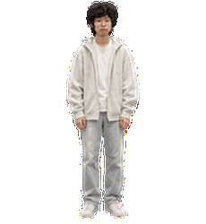

# 小码：ChatGPT Work 真人桌宠

小码是使用真人照片质感制作的 ChatGPT Work 桌宠。项目包含当前使用的 Pets v2 图集、约 20% 放大预览、动画预览，以及安装和显示尺寸调整教程。

## 项目文件

- SHOWCASE.md：项目介绍与 GIF 展示
- INSTALL.md：安装教程和尺寸调整说明
- xiaoma-spritesheet-v2.png：当前可用的透明 Pets v2 图集
- xiaoma-current-standard-atlas.gif：当前标准图集动作预览
- 20% 预览文件：xiaoma-all-states-20-percent.gif、xiaoma-atlas-20-percent-preview-only.png、xiaoma-contact-sheet-20-percent.png、xiaoma-four-stills-20-percent.jpg、xiaoma-all-states-20-percent.mp4

## 重要说明

ChatGPT 桌面应用可在 Settings > Pets > Customize > Pet size 调整桌宠显示尺寸。20% 放大预览文件用于展示效果；安装时使用标准 v2 图集，不要将大画布预览图集用作安装文件。

仓库为私有。为减少真人影像的暴露范围，本项目不包含原始相机照片。项目未附带再分发或商业使用许可。

安装步骤见 [INSTALL.md](INSTALL.md)。

## About：可复制给 AI 的安装提示词

从 GitHub 下载 xiaoma-spritesheet-v2.png，将它作为附件发给 ChatGPT Work，然后复制这段提示词：

https://github.com/dadonbei/cyj-chatgpt-work-pet请使用当前对话可用的 Pets 工具，使用我附加的 连接中找到xiaoma-spritesheet-v2.png 原样创建一个名为“小码”的 ChatGPT Work 自定义桌宠。先校验 Pets v2 图集格式，再创建并激活。保留真人照片外观和全部动作，不重新生成、不改画风。不要把 20% 预览图集用作安装文件。完成后告诉我安装结果。

